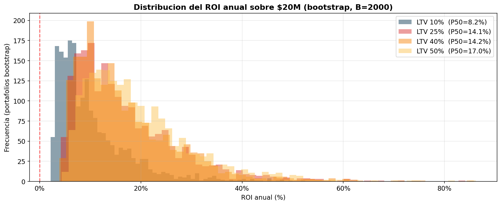
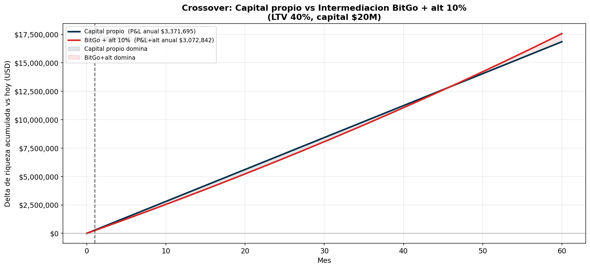

# Modelo Financiero — Crypto-Backed Loans

> **¿Cuánto retorno esperar al invertir $20M USD en operar 
> un negocio de préstamos colateralizados con BTC/ETH?**

> Fecha: 2026-05-05 07:36 · Datos históricos: 2017-08-16 a 2026-01-04 · Préstamos simulados por escenario: 5,000  

---

## Resumen ejecutivo

> **Pregunta:** si inviertes **$20,000,000 USD** en operar crypto-backed loans, 
> ¿cuánto retorno esperar y cuándo recuperas tu capital?

**Respuesta** (escenario recomendado: LTV inicial 40%):

| Métrica | Valor esperado |
|---|---|
| Monto promedio del préstamo | **$3,168,400** |
| Préstamos concurrentes (con $20M) | **6** (95.1% del capital deployed) |
| Préstamos otorgados al año | **5** |
| Capital total prestado al año | **$15,842,000** (reciclando el capital ~0.8× al año) |
| Duración promedio del préstamo | 12.5 meses |
| Utilidad anual (mediana, año 1) | **$2,847,164** |
| Rango razonable año 1 (P10–P90) | $1,420,822 – $6,049,305 |
| Retorno anual mediano (año 1) | **14.2%** |
| Rango retorno año 1 (P10–P90) | 7.1% – 30.2% |
| Retorno anual mediano (año 2+) | **14.4%** |
| Probabilidad de pérdida en año 1 | 0.0% |
| Préstamos para cubrir costos fijos (break-even) | **1** |
| Mes de recuperación del capital (reinvirtiendo todo) | **mes 44** |
| % de préstamos que terminan en liquidación | 26.7% |

> **¿Por qué LTV 40% y no otro?** ofrece el mejor balance 
> entre retorno y riesgo: liquidaciones controladas, baja pérdida real para el 
> prestamista (la mayoría se cubre con el colateral) y costos de custodia razonables. 
> Las otras 3 LTV se reportan en la sección **Palanca: LTV** como sensibilidad.

---

## 1. ¿De dónde sale el retorno?

Composición del ingreso neto promedio **por préstamo** (LTV 40%). 
Cada componente promediado sobre todos los préstamos simulados:

| Componente | USD por préstamo | % del ingreso bruto |
|---|---:|---:|
| Intereses cobrados | $603,951 | 80.8% |
| Cuota de apertura (2%) | $63,368 | 8.5% |
| Fee de liquidación | $79,945 | 10.7% |
| **Ingreso bruto** | $747,264 | 100.0% |
| Custodia (BitGo) | -$39,426 | -5.3% |
| Movimientos (BitGo) | -$23,763 | -3.2% |
| KYC (Complif) | -$4 | -0.0% |
| Pérdida por shortfall | -$47 | -0.0% |
| **Ingreso neto por préstamo** | $684,023 | 91.5% |

> **Lectura:** los **intereses** son la mayor fuente de ingreso; la **cuota de apertura** 
> aporta un cobro inmediato significativo dado el tamaño de los préstamos. La **custodia** 
> es el costo dominante porque escala con el colateral durante toda la vida del préstamo.

---

## 2. Break-even

Para cubrir los **$48,420** de costos fijos del año 1 
(Complif setup + mensualidades + desarrollo), se necesitan:

| Métrica | Valor |
|---|---|
| Préstamos para break-even (LTV 40%) | **1 préstamo** |
| Capital nominal en circulación equivalente | $3,168,400 |
| Costos fijos año 1 | $48,420 |
| Costos fijos año 2+ | $17,340 |
| Ingreso neto promedio por préstamo | $684,023 |

> **Lectura:** la operación cubre sus costos fijos con muy pocos préstamos dada la 
> escala de los montos. Más allá del break-even, cada préstamo adicional aporta 
> directamente al retorno del accionista.

---

## 3. Rango de retornos esperados

Distribución del retorno anual generada por bootstrap de portafolio: para cada LTV 
se construyen 2,000 portafolios sintéticos con el número de préstamos esperados al 
año, sampleando con reemplazo de las 5,000 simulaciones individuales. Esto captura 
la variabilidad real entre escenarios (préstamos que se liquidan vs. los que pagan).

| LTV | ROI año 1 P10 | ROI año 1 mediano | ROI año 1 P90 | P(pérdida año 1) | Utilidad mediana año 1 |
|---|---:|---:|---:|---:|---:|
| 10% | 3.8% | **8.2%** | 19.9% | 0.0% | $1,644,949 |
| 25% | 7.0% | **14.1%** | 30.2% | 0.0% | $2,829,765 |
| 40% | 7.1% | **14.2%** | 30.2% | 0.0% | $2,847,164 |
| 50% | 8.6% | **17.0%** | 33.2% | 0.0% | $3,407,884 |

> **Cómo leer P10–P90:** en el 10% peor de los escenarios obtienes a lo sumo el ROI P10. 
> En la mediana (P50) obtienes el ROI más probable. En el 10% mejor superas el P90. 
> Es el rango razonable de resultados, no el mejor ni el peor caso absoluto.



---

## 4. Palanca: LTV inicial

El LTV inicial es la palanca principal del modelo: balancea retorno y riesgo. 
Más conservador (LTV 10%) → menos liquidaciones pero menor turnover; más agresivo 
(LTV 50%) → mayor turnover y retorno, pero más liquidaciones.

|                             | 10%        | 25%        | 40%        | 50%        |
|:----------------------------|:-----------|:-----------|:-----------|:-----------|
| Monto promedio del préstamo | $3,108,600 | $3,097,400 | $3,168,400 | $3,066,800 |
| Duración promedio (meses)   | 15.1       | 14.4       | 12.5       | 10.8       |
| Ingreso neto por préstamo   | $526,828   | $678,699   | $684,023   | $647,885   |
| Préstamos concurrentes      | 6          | 6          | 6          | 6          |
| Reciclos del capital al año | 0.8        | 0.83       | 0.96       | 1.11       |
| Préstamos totales al año    | 4          | 5          | 5          | 6          |
| Utilidad año 1              | $2,058,893 | $3,345,077 | $3,371,695 | $3,838,892 |
| Retorno año 1               | 10.3%      | 16.7%      | 16.9%      | 19.2%      |
| Utilidad año 2              | $2,089,973 | $3,376,157 | $3,402,775 | $3,869,972 |
| Retorno año 2               | 10.4%      | 16.9%      | 17.0%      | 19.3%      |
| Préstamos para break-even   | 1          | 1          | 1          | 1          |


---

## 5. Trayectoria mensual y auto-fondeo

Si **se reinvierten todos los ingresos netos** en nuevos préstamos en lugar de 
retirarlos, el negocio alcanza auto-fondeo cuando las utilidades acumuladas igualan 
el capital inicial ($20,000,000). En ese momento, el capital original puede 
retirarse y la operación se sostiene con sus propios ingresos.

| LTV | Mes de auto-fondeo | Utilidad acumulada al mes 60 |
|---|---|---:|
| 10% | >60 | $17,381,906 |
| 25% | Mes 49 | $27,082,955 |
| 40% | Mes 44 | $32,928,016 |
| 50% | Mes 39 | $40,208,741 |


---

## 6. Sensibilidad: cuota de apertura

La cuota de apertura (cobrada al originar el préstamo) es la palanca comercial 
más directa. Resultados con LTV 50%:

| Cuota de apertura   | Ingreso neto por préstamo   | Utilidad anual   | Retorno anual   |
|:--------------------|:----------------------------|:-----------------|:----------------|
| 1.0%                | $617,217                    | $3,654,884       | 18.3%           |
| 1.5%                | $632,551                    | $3,746,888       | 18.7%           |
| 2.0%                | $647,885                    | $3,838,892       | 19.2%           |
| 2.5%                | $663,219                    | $3,930,896       | 19.7%           |
| 3.0%                | $678,553                    | $4,022,900       | 20.1%           |

---

## 7. Riesgo de mercado

### 7.1 Volatilidad histórica del colateral

Volatilidad anualizada (ventana rodante 30 días) sobre datos horarios. Es el 
driver principal del riesgo de margin call y liquidación.

| Métrica | BTC (%) | ETH (%) |
|---|---:|---:|
| Volatilidad actual (30d) | 40.4 | 57.8 |
| Volatilidad actual (90d) | 46.2 | 69.7 |
| Volatilidad actual (365d) | 44.5 | 72.7 |
| Media histórica (30d) | 64.9 | 82.9 |
| P25 histórico (30d) | 45.3 | 60.7 |
| P75 histórico (30d) | 71.9 | 95.3 |
| Mínimo histórico (30d) | 18.2 | 21.8 |
| Máximo histórico (30d) | 190.4 | 230.1 |

> **BTC:** régimen de volatilidad **BAJA** (actual 40.4%, rango histórico 18.2–190.4%)  
> **ETH:** régimen de volatilidad **BAJA** (actual 57.8%, rango histórico 21.8–230.1%)  


### 7.2 Buffer de protección requerido al cliente

Buffer mínimo de colateral extra (% del colateral inicial) que el cliente debe 
provisionar al inicio para evitar liquidación en un horizonte de 1 año.

| LTV | Moneda | Buffer P90 (%) | Buffer P95 (%) | Buffer P99 (%) |
|---|---|---:|---:|---:|
| 10% | BTC | 0.0 | 0.0 | 0.0 |
| 10% | ETH | 0.0 | 0.0 | 50.9 |
| 25% | BTC | 0.0 | 0.0 | 45.1 |
| 25% | ETH | 39.4 | 112.5 | 277.2 |
| 40% | BTC | 32.8 | 53.1 | 132.2 |
| 40% | ETH | 123.1 | 240.0 | 503.5 |
| 50% | BTC | 65.9 | 91.4 | 190.3 |
| 50% | ETH | 178.9 | 324.9 | 654.4 |

> **Lectura:** si el cliente provisiona al menos el buffer P90, evita la liquidación 
> en ≥90% de los escenarios históricos.

### 7.3 Predicción de precios futuros (Monte Carlo)

Simulación Monte Carlo con Bootstrap-KDE sobre retornos históricos, horizonte de 
365 días, 2,000 trayectorias por activo.

| Métrica | BTC | ETH |
|---|---:|---:|
| Precio inicial | $91,140.00 | $3,149.74 |
| Precio mediano final | $90,662.95 | $3,193.59 |
| Percentil 5% final | $28,516.54 | $716.46 |
| P(caída ≥20%) | 36.5% | 40.1% |
| P(caída ≥40%) | 22.7% | 27.6% |


---

## 8. Alternativa: intermediación con BitGo + cobertura

Escenario alternativo donde **BitGo financia los préstamos al 9.5% anual** y x2o cobra una **cobertura adicional de 4.5%** (volatility insurance / 
liquidation hedge). x2o presta al 18–20% 
y retiene el **diferencial neto de ~5.0%** sobre el principal. 
**No se requiere capital propio** para fondear los préstamos; solo para los costos operativos.

| Concepto | Valor |
|---|---|
| Tasa BitGo (costo de fondeo) | **9.5% anual** |
| Costo de cobertura (hedge) | **4.5% anual** |
| Tasa x2o BTC / ETH | 18% / 20% |
| Tasa promedio ponderada | ~19.0% |
| **Diferencial neto** | **~5.0% sobre principal** |
| LTV de liquidación BitGo | 85% |
| LTV de liquidación x2o | 80% (margen de seguridad: 5pp) |
| Capital propio requerido | $0 (fondeo externo) |

| LTV   | Intereses cobrados   | Costo de fondeo (BitGo)   | Costo_cobertura_prom   | Spread neto por préstamo   | Utilidad anual con spread   | Capital propio requerido   |
|:------|:---------------------|:--------------------------|:-----------------------|:---------------------------|:----------------------------|:---------------------------|
| 10%   | $742,959             | $372,399                  | $176,399               | $-21,970                   | $-136,300                   | $0 (fondeo BitGo)          |
| 25%   | $697,838             | $355,255                  | $168,279               | $155,166                   | $727,408                    | $0 (fondeo BitGo)          |
| 40%   | $603,951             | $311,987                  | $147,783               | $224,252                   | $1,072,842                  | $0 (fondeo BitGo)          |
| 50%   | $510,806             | $262,864                  | $124,515               | $260,507                   | $1,514,620                  | $0 (fondeo BitGo)          |

> **Ventaja:** ROI teóricamente infinito (sin capital propio comprometido). 
> **Trade-off:** menor ingreso neto por préstamo vs. modelo con capital propio, 
> y dependencia de la relación comercial con BitGo.

---

## 9. ¿Cuándo conviene capital propio vs BitGo?

Comparativa directa de utilidad acumulada mes a mes. La pregunta concreta: 
si tienes $20,000,000 **disponibles** para invertir, ¿conviene **comprometerlos como 
capital propio** (otorgando los préstamos directamente) o **dejarlos en una alternativa 
líquida** (CETES, bonos) y operar vía intermediación BitGo?

**Asunción clave** del análisis: si vas con BitGo, los $20M libres ganan una **tasa 
alternativa del 10% anual** (referencia: CETES MX). Si esa 
tasa fuera 0%, capital propio gana siempre desde el primer mes.

### P&L mensual de cada modelo (LTV 40%)

| Métrica | Capital propio | BitGo + alt |
|---|---:|---:|
| Préstamos al año | 5 | 5 |
| Ingreso neto / préstamo | $674,339 | $214,568 |
| **Utilidad anual operativa** | **$3,371,695** | **$1,072,842** |
| Yield sobre $20M alt (10%) | $0 (capital comprometido) | $2,000,000 |
| **Total anual** | **$3,371,695** | **$3,072,842** |

### Mes de crossover (cuándo capital propio supera a BitGo+alt)

Con tasa alternativa 10% anual, capital propio supera a BitGo+alt en **el mes 1**.

### Sensibilidad a la tasa alternativa

Si la tasa alternativa cambia, el mes de crossover también:

| Tasa alternativa anual | Mes de crossover |
|---|---|
| 0.0% | Mes 1 |
| 5.0% | Mes 1 |
| 8.0% | Mes 1 |
| 10.0% | Mes 1 |
| 12.0% | Mes 1 |
| 15.0% | >60 meses |



> **Lectura para el accionista:** capital propio gana en absoluto pero requiere comprometer 
> los $20,000,000. Si esos fondos pueden ganar más del 10% 
> en otra inversión líquida, BitGo+alt domina hasta el mes de crossover. Si no tienes una 
> alternativa con yield decente, capital propio gana siempre.

---

## 10. Vista de contador — Estado de resultados anual

Estado de resultados comparativo (base anual), con desglose por componente para 
trazabilidad contable. Todos los números son promedio anual operando estable, 
basados en **5 préstamos al año** de **$3,168,400 
promedio** y duración promedio **12.5 meses**.

### Modelo A — Capital propio ($20M comprometidos)

| Concepto | Por préstamo | Anual (5 préstamos) |
|---|---:|---:|
| Intereses cobrados al cliente | $603,951 | $3,019,753 |
| Cuota de apertura | $63,368 | $316,840 |
| Fee de liquidación | $79,945 | $399,727 |
| **(=) Ingresos totales** | **$747,264** | **$3,736,320** |
| (−) Custodia (BitGo) | -$39,426 | -$197,132 |
| (−) Movimientos (BitGo) | -$23,763 | -$118,815 |
| (−) KYC (Complif) | -$4 | -$22 |
| (−) Pérdida por shortfall | -$47 | -$235 |
| **(=) Margen bruto operativo** | — | **$3,420,115** |
| (−) Costos fijos (año 1: setup + mensual + dev) | — | -$48,420 |
| **(=) Utilidad neta operativa anual** | — | **$3,371,695** |
| Capital comprometido | — | $20,000,000 |
| **ROI sobre capital** | — | **16.9%** |

### Modelo B — Intermediación BitGo + cobertura ($0 capital propio)

| Concepto | Por préstamo | Anual (5 préstamos) |
|---|---:|---:|
| Intereses cobrados al cliente | $603,951 | $3,019,753 |
| (−) Costo de fondeo BitGo (9.5%) | -$311,987 | -$1,559,936 |
| (−) Costo de cobertura (4.5%) | -$147,783 | -$738,917 |
| Cuota de apertura | $63,368 | $316,840 |
| Fee de liquidación | $79,945 | $399,727 |
| **(=) Ingreso neto por intermediación (spread + fees)** | — | **$1,437,467** |
| (−) Custodia, movimientos, KYC | — | -$315,969 |
| (−) Pérdida por shortfall | — | -$235 |
| **(=) Margen bruto operativo** | — | **$1,121,262** |
| (−) Costos fijos | — | -$48,420 |
| **(=) Utilidad neta operativa anual** | — | **$1,072,842** |
| Capital comprometido | — | $0 |
| **ROI sobre capital** | — | **infinito** |

### Comparativa directa

| Métrica anual | Modelo A (Capital propio) | Modelo B (BitGo + cobertura) |
|---|---:|---:|
| Ingresos | $3,736,320 | $3,736,320 |
| (−) Costos de fondeo (BitGo + cobertura) | $0 | -$2,298,853 |
| (−) Costos variables operativos | -$316,205 | -$316,205 |
| (−) Costos fijos | -$48,420 | -$48,420 |
| **Utilidad neta anual** | **$3,371,695** | **$1,072,842** |
| Capital propio comprometido | $20,000,000 | $0 |
| ROI sobre capital | 16.9% | infinito |
| Diferencia absoluta (A − B) | — | **$2,298,853/año extra** |

> **Nota contable:** los $20M comprometidos en Modelo A no son un *gasto* contable — 
> permanecen como cuentas por cobrar (préstamos otorgados) en el balance. Lo que cambia 
> es la **liquidez**: en A no puedes disponer del capital, en B sí.

---

## Anexo A — Comportamiento del préstamo individual

Métricas operativas promedio por préstamo bajo cada escenario de LTV. Estas son las 
variables que alimentan el modelo financiero anterior:

|                                             | 10%       | 25%       | 40%       | 50%       |
|:--------------------------------------------|:----------|:----------|:----------|:----------|
| Préstamos simulados                         | 5000      | 5000      | 5000      | 5000      |
| Monto promedio del préstamo (USD)           | 3108600.0 | 3097400.0 | 3168400.0 | 3066800.0 |
| Duración promedio (meses)                   | 15.1      | 14.4      | 12.5      | 10.8      |
| % de préstamos liquidados                   | 1.0%      | 9.1%      | 26.7%     | 42.7%     |
| % con pérdida para el prestamista           | 0.0%      | 0.0%      | 0.1%      | 0.1%      |
| Margin calls promedio por préstamo          | 0.02      | 0.18      | 0.5       | 0.72      |
| Recapitalizaciones promedio                 | 0.46      | 0.42      | 0.33      | 0.26      |
| % cerrados con colateral (no repago)        | 9.9%      | 8.8%      | 7.2%      | 5.9%      |
| Intereses cobrados promedio (USD)           | 742959.0  | 697838.0  | 603951.0  | 510806.0  |
| Cuota de apertura promedio (USD)            | 62172.0   | 61948.0   | 63368.0   | 61336.0   |
| Fee de liquidación promedio (USD)           | 3119.0    | 27886.0   | 79945.0   | 120850.0  |
| Pérdida promedio cuando hay shortfall (USD) | 0.0       | 0.0       | 47.0      | 89.0      |
| Ingreso bruto por préstamo (USD)            | 808250.0  | 787672.0  | 747264.0  | 692992.0  |


---

## Anexo B — Estructura de costos

### Costos variables promedio por préstamo

| LTV   | Custodia (BitGo)   | Movimientos (BitGo)   | KYC (Complif)   | Costo variable total   | Ingreso bruto   | Pérdida por liquidación   | Ingreso neto   |
|:------|:-------------------|:----------------------|:----------------|:-----------------------|:----------------|:--------------------------|:---------------|
| 10%   | $188,159           | $93,258               | $4.45           | $281,422               | $808,250        | $0                        | $526,828       |
| 25%   | $71,799            | $37,169               | $4.45           | $108,972               | $787,672        | $0                        | $678,699       |
| 40%   | $39,426            | $23,763               | $4.45           | $63,194                | $747,264        | $47                       | $684,023       |
| 50%   | $26,613            | $18,401               | $4.45           | $45,019                | $692,992        | $89                       | $647,885       |

### Costos fijos anuales

| Concepto | Año 1 | Año 2+ |
|---|---:|---:|
| Complif Setup | $12,750 | $0 |
| Complif mensual (×12) | $17,340 | $17,340 |
| Desarrollo | $18,330 | $0 |
| **Total** | **$48,420** | **$17,340** |

---

## Anexo C — Parámetros del modelo y flujo

### Parámetros

| Parámetro | Valor |
|---|---|
| Escenarios LTV | 10%, 25%, 40%, 50% |
| Margin call / Liquidación LTV | 72% / 80% |
| Tasa anual BTC / ETH | 18% / 20% |
| Cuota de apertura | 2% |
| Fee de liquidación | 8% |
| P(recapitalizar) base | 40% (decae por recapitalización) |
| P(pagar al vencimiento) | 90% |
| Montos de préstamo | $1,000,000 – $20,000,000 USD |

### Flujo del préstamo

```
Inicio -> [Devengar interés] -> ¿Margin Call?
  |                                |
  |                       Sí: P(agregar colateral) -> Continúa
  |                           P(amortizar)         -> Continúa
  |                           P(ignorar)           -> Liquidación
  |
  +-> ¿Vencimiento?
        |
        Sí: P(recapitalizar) -> Paga intereses, extiende N meses -> Continúa
            Ninguno:
              P(pagar préstamo)  -> Cierre con repago (alta prob.)
              P(usar colateral)  -> Cierre con colateral (baja prob.)
```

---

## Conclusiones

1. **Retorno esperado** (LTV 40%, año 1): mediana 14.2%, rango razonable 7.1%–30.2% sobre los $20M.
2. **Break-even temprano**: muy pocos préstamos cubren los costos fijos dada la 
   escala de los montos ($100K–$20M).
3. **Recapitalización** es la herramienta clave para extender la vida del préstamo y 
   generar ingresos recurrentes.
4. **Cierre al vencimiento**: alta probabilidad de repago (cliente protege su colateral); 
   uso de colateral para cubrir deuda es poco probable.
5. **LTV como palanca**: subir el LTV aumenta el retorno mediano pero también la 
   probabilidad de liquidación; LTV recomendado balancea ambos.
6. **Alternativa BitGo**: permite operar sin capital propio comprometido, a cambio de 
   menor ingreso neto por préstamo.

---
*Generado automáticamente por modelo_financiero.ipynb — 2026-05-05*