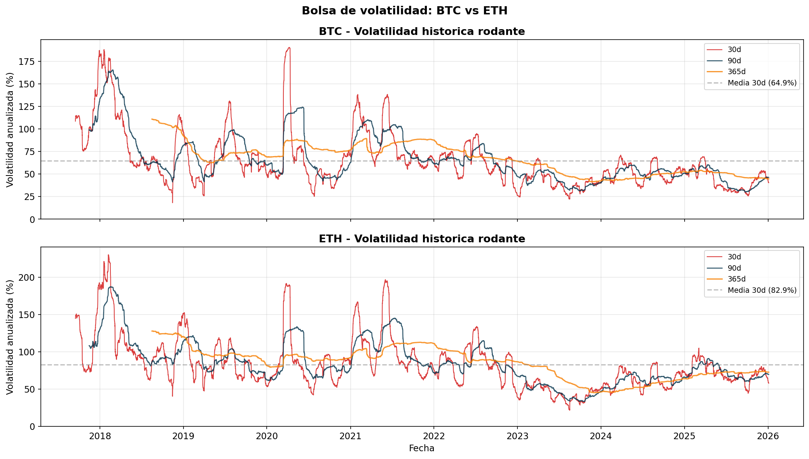
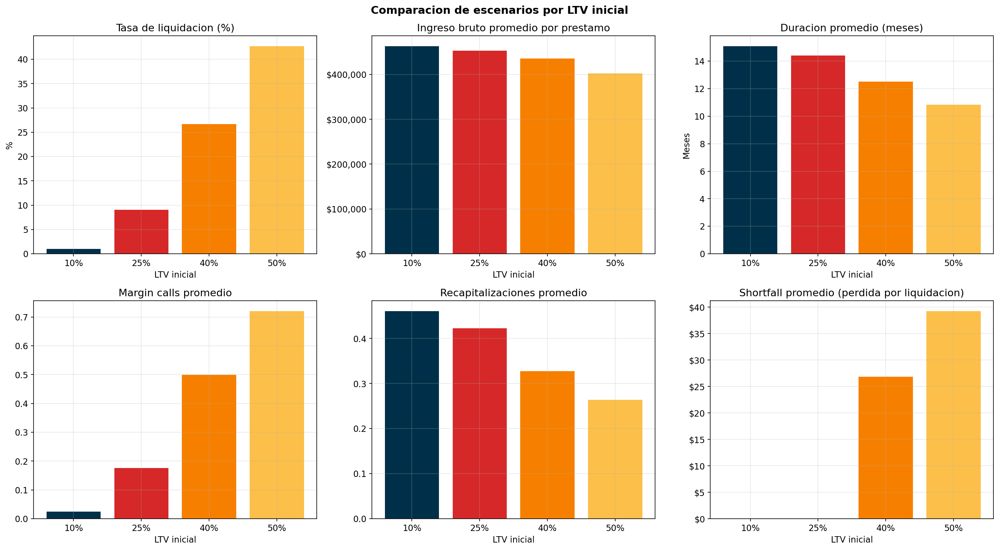
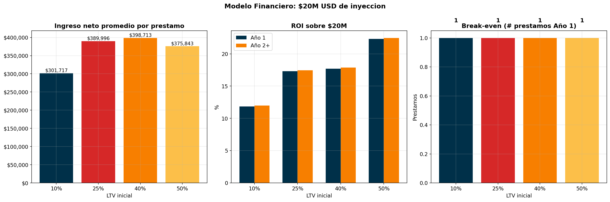
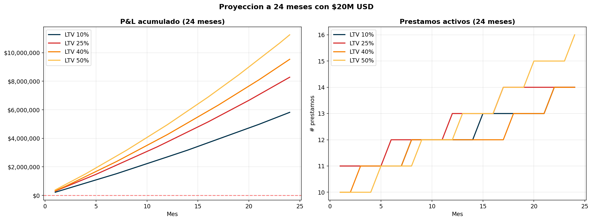
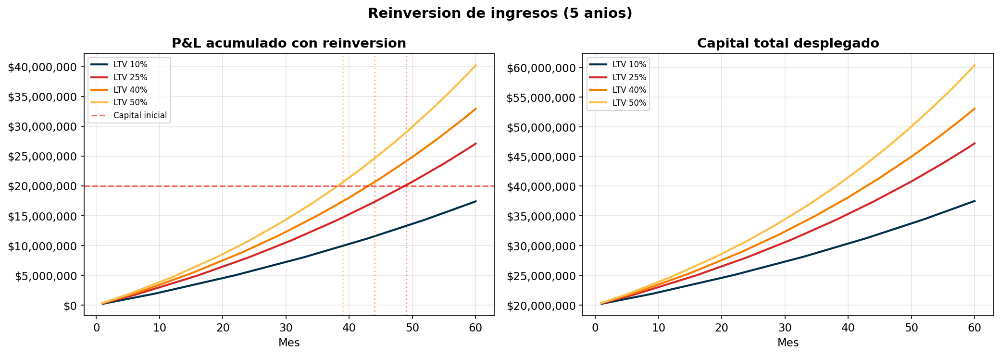
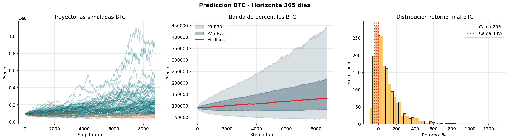
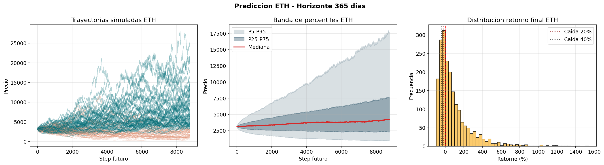

# Reporte: Modelo Financiero - Crypto-Backed Loans

> **Fecha:** 2026-04-20 10:51  
> **Datos historicos:** 2017-08-16 a 2026-01-04  
> **Prestamos simulados por escenario:** 5,000  
> **Capital:** $20,000,000 USD

---

## 1. Parametros del modelo

| Parametro | Valor |
|---|---|
| Escenarios LTV | 10%, 25%, 40%, 50% |
| Margin call / Liquidacion LTV | 72% / 80% |
| Tasa anual BTC / ETH | 18% / 20% |
| Cuota apertura | 2% |
| Fee liquidacion | 8% |
| P(recapitalizar) base | 40% (decae por recapitalizacion) |
| P(pagar al vencimiento) | 90% |
| Montos prestamo | $100,000 - $20,000,000 USD |

### Bolsa de volatilidad

Volatilidad anualizada historica (ventana rodante 30d) sobre datos horarios.

| Metrica | BTC (%) | ETH (%) |
|---|---|---|
| Vol actual (30d) | 40.4 | 57.8 |
| Vol actual (90d) | 46.2 | 69.7 |
| Vol actual (365d) | 44.5 | 72.7 |
| Media historica (30d) | 64.9 | 82.9 |
| P25 (30d) | 45.3 | 60.7 |
| P75 (30d) | 71.9 | 95.3 |
| Min (30d) | 18.2 | 21.8 |
| Max (30d) | 190.4 | 230.1 |

> **BTC:** Regimen de volatilidad **BAJA** (actual 40.4%, rango historico 18.2-190.4%)  
> **ETH:** Regimen de volatilidad **BAJA** (actual 57.8%, rango historico 21.8-230.1%)  



### Analisis de buffer (bolsa de volatilidad)

Buffer minimo de colateral extra (% del colateral inicial) que el cliente debe
provisionar desde el inicio para evitar liquidacion en un horizonte de 1 anio.

| LTV | Moneda | Buffer P90 (%) | Buffer P95 (%) | Buffer P99 (%) |
|---|---|---|---|---|
| 10% | BTC | 0.0 | 0.0 | 0.0 |
| 10% | ETH | 0.0 | 0.0 | 50.9 |
| 25% | BTC | 0.0 | 0.0 | 45.1 |
| 25% | ETH | 39.4 | 112.5 | 277.2 |
| 40% | BTC | 32.8 | 53.1 | 132.2 |
| 40% | ETH | 123.1 | 240.0 | 503.5 |
| 50% | BTC | 65.9 | 91.4 | 190.3 |
| 50% | ETH | 178.9 | 324.9 | 654.4 |

> **Interpretacion:** si el cliente provisiona al menos el buffer P90, evita liquidacion en >=90% de los escenarios historicos.


---

## 2. Flujo del prestamo

```
Inicio -> [Devengar interes] -> Margin Call?
  |                               |
  |                     Si: P(agregar colateral) -> Continua
  |                         P(amortizar)         -> Continua
  |                         P(ignorar)           -> Busca liquidacion
  |
  +-> Vencimiento?
        |
        Si: P(recapitalizar) -> Paga intereses, extiende N meses -> Continua
            Ninguno:
              P(pagar prestamo)  -> Cierre con repago (alta prob.)
              P(usar colateral)  -> Cierre con colateral (baja prob.)
```

---

## 3. Resultados por escenario de LTV

|                         | 10%       | 25%       | 40%       | 50%       |
|:------------------------|:----------|:----------|:----------|:----------|
| N_prestamos             | 5000      | 5000      | 5000      | 5000      |
| Principal_prom_USD      | 1780510.0 | 1779210.0 | 1860450.0 | 1779620.0 |
| Duracion_prom_meses     | 15.1      | 14.4      | 12.5      | 10.8      |
| Tasa_liquidacion        | 1.0%      | 9.1%      | 26.7%     | 42.7%     |
| Tasa_shortfall          | 0.0%      | 0.0%      | 0.1%      | 0.1%      |
| Margin_calls_prom       | 0.02      | 0.18      | 0.5       | 0.72      |
| Recapitalizaciones_prom | 0.46      | 0.42      | 0.33      | 0.26      |
| Settled_collateral      | 9.9%      | 8.8%      | 7.2%      | 5.9%      |
| Interes_prom_USD        | 425171.0  | 400759.0  | 350353.0  | 295566.0  |
| Opening_fee_prom_USD    | 35610.0   | 35584.0   | 37209.0   | 35592.0   |
| Liq_fee_prom_USD        | 1895.0    | 16173.0   | 48015.0   | 70815.0   |
| Shortfall_prom_USD      | 0.0       | 0.0       | 27.0      | 39.0      |
| Ingreso_bruto_prom_USD  | 462677.0  | 452516.0  | 435577.0  | 401974.0  |

### Comparacion grafica



---

## 4. Estructura de costos

### Costos variables promedio por prestamo

| LTV   | Custodia_prom   | Outgoing_prom   | KYC   | Total_var_prom   | Ingreso_bruto_prom   | Shortfall_prom   | Ingreso_neto_prom   |
|:------|:----------------|:----------------|:------|:-----------------|:---------------------|:-----------------|:--------------------|
| 10%   | $107,540        | $53,415         | $4.45 | $160,960         | $462,677             | $0               | $301,717            |
| 25%   | $41,165         | $21,351         | $4.45 | $62,520          | $452,516             | $0               | $389,996            |
| 40%   | $22,880         | $13,953         | $4.45 | $36,837          | $435,577             | $27              | $398,713            |
| 50%   | $15,409         | $10,678         | $4.45 | $26,091          | $401,974             | $39              | $375,843            |

### Costos fijos anuales

| Concepto | Anio 1 | Anio 2+ |
|---|---|---|
| Complif Setup | $12,750 | $0 |
| Complif Mensual (x12) | $17,340 | $17,340 |
| Desarrollo | $18,330 | $0 |
| **Total** | **$48,420** | **$17,340** |

---

## 5. Modelo financiero: P&L con $20M USD

|                           | 10%        | 25%        | 40%        | 50%        |
|:--------------------------|:-----------|:-----------|:-----------|:-----------|
| Principal_prom            | $1,780,510 | $1,779,210 | $1,860,450 | $1,779,620 |
| Duracion_prom_meses       | 15.1       | 14.4       | 12.5       | 10.8       |
| Ingreso_neto_por_prestamo | $301,717   | $389,996   | $398,713   | $375,843   |
| Prestamos_concurrentes    | 11         | 11         | 10         | 11         |
| Turnover_anual            | 0.8        | 0.83       | 0.96       | 1.11       |
| Total_prestamos_año       | 8          | 9          | 9          | 12         |
| P&L_Año1                  | $2,365,313 | $3,461,545 | $3,539,996 | $4,461,700 |
| ROI_Año1                  | 11.8%      | 17.3%      | 17.7%      | 22.3%      |
| P&L_Año2                  | $2,396,393 | $3,492,625 | $3,571,076 | $4,492,780 |
| ROI_Año2                  | 12.0%      | 17.5%      | 17.9%      | 22.5%      |
| Break_even_prestamos      | 1          | 1          | 1          | 1          |

### Visualizacion P&L y ROI



### Proyeccion a 24 meses



---

## 6. Sensibilidad: Cuota de apertura (LTV 50%)

| Cuota_apertura   | Ingreso_neto_prom   | P&L_anual   | ROI   |
|:-----------------|:--------------------|:------------|:------|
| 1.0%             | $358,047            | $4,248,146  | 21.2% |
| 1.5%             | $366,945            | $4,354,923  | 21.8% |
| 2.0%             | $375,843            | $4,461,700  | 22.3% |
| 2.5%             | $384,741            | $4,568,478  | 22.8% |
| 3.0%             | $393,640            | $4,675,255  | 23.4% |

---

### 6.1 Reinversion de ingresos y auto-fondeo

Si se reinvierten **todos** los ingresos netos en nuevos prestamos,
el negocio alcanza auto-fondeo cuando las utilidades acumuladas igualan el capital inicial ($20,000,000).

| LTV | Auto-fondeo (mes) | P&L acumulado mes 60 |
|---|---|---|
| 10% | >60 | $18,145,090 |
| 25% | Mes 48 | $28,075,681 |
| 40% | Mes 43 | $33,693,082 |
| 50% | Mes 38 | $41,886,155 |

> **Interpretacion:** una vez alcanzado el auto-fondeo, el capital original puede retirarse
> o reasignarse; la operacion se sostiene con sus propios ingresos.



---

### 6.2 Modelo de intermediacion con BitGo

Escenario alternativo: BitGo fondea los prestamos al **11%** anual; x2o presta al **18-20%** y retiene el spread.
No se requiere capital propio para el fondeo — solo para costos operativos.

| Concepto | Valor |
|---|---|
| Tasa BitGo (costo de fondeo) | 11% anual |
| Tasa x2o BTC / ETH | 18% / 20% |
| LTV liquidacion BitGo | 85% |
| LTV liquidacion x2o | 80% (margen de seguridad: 5pp) |
| Capital propio requerido | $0 (fondeo externo) |

| LTV | Interes prom | Costo BitGo prom | Spread neto prom | P&L anual spread |
|---|---|---|---|---|
| 10% | $425,171 | $246,452 | $55,264 | $393,690 |
| 25% | $400,759 | $234,856 | $155,140 | $1,347,843 |
| 40% | $350,353 | $213,177 | $185,536 | $1,621,408 |
| 50% | $295,566 | $176,182 | $199,661 | $2,347,507 |

> **Ventaja:** ROI teoricamente infinito (sin capital propio comprometido).
> **Trade-off:** menor ingreso neto por prestamo vs modelo con capital propio,
> y dependencia de la relacion comercial con BitGo.

---
## 7. Prediccion de precios futuros (Monte Carlo Bootstrap)

Simulacion Monte Carlo con Bootstrap-KDE sobre retornos historicos,
horizonte de 365 dias, 2,000 trayectorias por activo.

| Metrica | BTC | ETH |
|---|---|---|
| Precio inicial | $91,140.00 | $3,149.74 |
| Precio mediano final | $131,164.59 | $4,221.92 |
| Percentil 5% final | $41,235.66 | $947.21 |
| P(caida >=20%) | 19.4% | 27.9% |
| P(caida >=40%) | 10.4% | 19.1% |

### Graficas de prediccion





---

## 8. Conclusiones

1. **Recapitalizacion** es la herramienta clave para extender la vida del prestamo y generar ingresos recurrentes.
2. **Cierre al vencimiento:** alta probabilidad de repago (cliente protege su colateral); uso de colateral para cubrir deuda es poco probable.
3. **LTV 40-50%** ofrece el mejor balance entre riesgo controlado y costos de custodia.
4. **Break-even** se alcanza con muy pocos prestamos dada la escala de montos ($100K-$20M).
5. **Cuota de apertura** del 2% genera ingreso inmediato significativo en prestamos grandes.
6. **Prediccion de precios:** Las simulaciones Monte Carlo Bootstrap-KDE permiten estimar probabilidades de caida del colateral, complementando el analisis de riesgo historico.

---
*Generado automaticamente por modelo_financiero.ipynb — 2026-04-20*