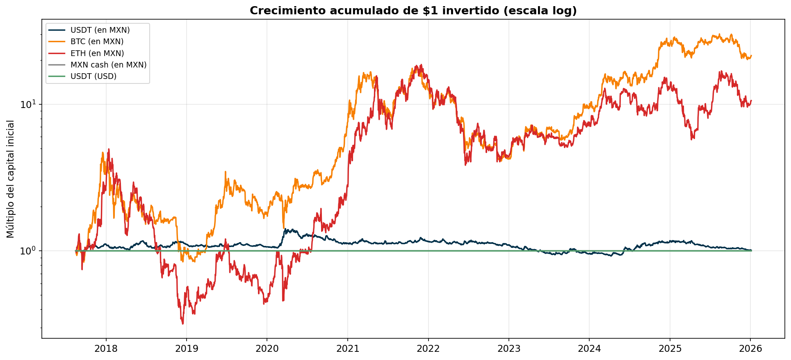
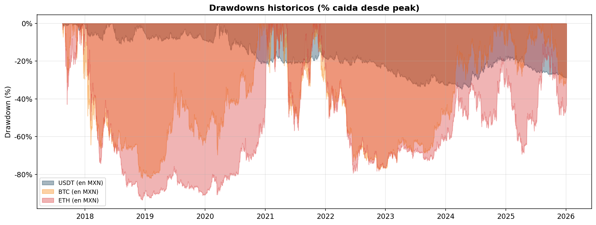
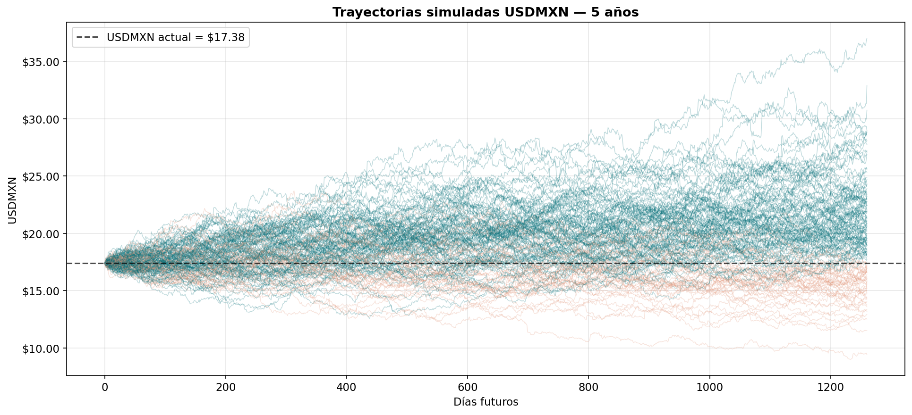
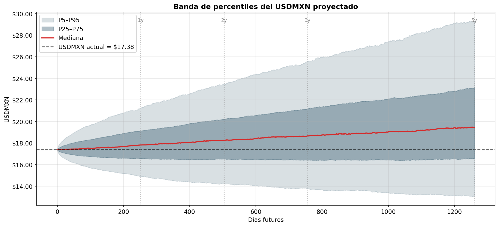
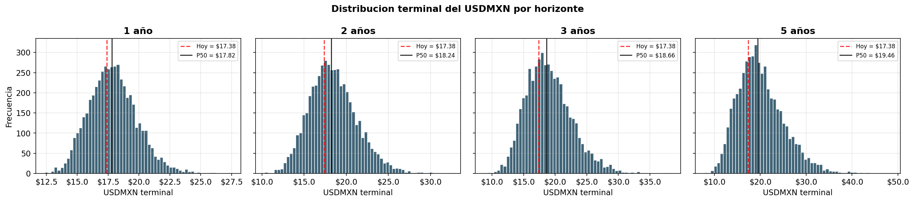
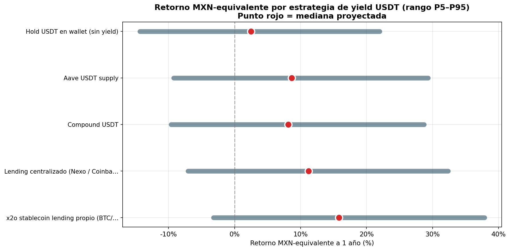

# Análisis de inversión en USDT

> **Perspectiva del prestamista mexicano:** ¿conviene tener capital en USDT en lugar de 
> MXN? ¿Qué retorno esperar a 1, 3 y 5 años? Análisis sobre datos históricos del tipo 
> de cambio peso-dólar (Banxico, 2001–2026) y precios de BTC/ETH (Binance, 1-min).

> Fecha de análisis: 2026-04-28 02:14  
> Periodo común BTC/ETH/USDMXN: 2017-08-16 a 2026-01-04  
> Tipo de cambio: 2000-01-03 = $9.3949 → 2026-04-27 = $17.3838 (apreciación USD acumulada: 85.0%)

---

## Resumen ejecutivo

> **Pregunta:** si tienes **$100,000 USD disponibles**, ¿conviene mantenerlos en 
> USDT (con yield) o convertirlos a MXN? ¿Cuánto valor en pesos esperarás en 1, 3 y 5 años?

**Respuesta** (USDT con yield 6.0% APY — *Aave USDT supply*):

| Horizonte | USDMXN esperado (mediana) | USDT con yield: valor en MXN (mediana) | Rango P5–P95 (MXN) | P(MXN se devalúa ≥10%) |
|---|---:|---:|---:|---:|
| 1 año | $17.82 | **$1,888,710 MXN** | $1,578,357 – $2,247,932 | 25.3% |
| 3 años | $18.66 | **$2,222,053 MXN** | $1,642,976 – $3,043,943 | 44.9% |
| 5 años | $19.46 | **$2,603,760 MXN** | $1,749,834 – $3,923,931 | 53.0% |

> **Lectura rápida:** el USDT te protege contra la devaluación del peso (la palanca más 
> grande del retorno en MXN); el yield USD añade un colchón adicional. La sección 3 
> compara estrategias específicas de yield (Aave, Compound, lending privado, x2o 
> stablecoin) y su retorno en términos MXN.

---

## 1. USDT vs BTC vs ETH vs MXN — comparativa histórica

Periodo: **2017-08-16 a 2026-01-04**. Métricas anualizadas 
calculadas sobre retornos diarios. *MXN-cash* = mantener pesos en efectivo (sin yield 
ni inflación). *USDT (USD)* = mantener USDT en wallet, sin yield (preserva valor en USD 
pero pierde poder adquisitivo en MXN si el dólar se debilita). *USDT (MXN)* = USDT 
medido en pesos = curva del USDMXN exactamente.

| Activo                      | Periodo   | CAGR   | Vol anualizada   | Max Drawdown   | Sharpe-ish (CAGR/vol)   | Mejor año   | Peor año   |
|:----------------------------|:----------|:-------|:-----------------|:---------------|:------------------------|:------------|:-----------|
| USDT (USD)                  | 2017–2026 | 0.00%  | 0.00%            | 0.00%          | —                       | 0.0%        | 0.0%       |
| MXN cash (en MXN)           | 2017–2026 | 0.00%  | 0.00%            | 0.00%          | —                       | 0.0%        | 0.0%       |
| USDT (en MXN)               | 2017–2026 | 0.11%  | 9.81%            | -34.97%        | 0.01                    | 22.9%       | -13.4%     |
| USDT (en MXN) — serie larga | 2000–2026 | 2.37%  | 10.86%           | -34.97%        | 0.22                    | 26.7%       | -13.4%     |
| BTC (USD)                   | 2017–2026 | 44.00% | 56.98%           | -83.16%        | 0.77                    | 305.1%      | -72.8%     |
| ETH (USD)                   | 2017–2026 | 32.36% | 73.81%           | -94.01%        | 0.44                    | 473.1%      | -82.4%     |
| BTC (en MXN)                | 2017–2026 | 44.16% | 57.14%           | -82.11%        | 0.77                    | 327.5%      | -72.9%     |
| ETH (en MXN)                | 2017–2026 | 32.51% | 73.32%           | -93.61%        | 0.44                    | 504.9%      | -82.4%     |
| MXN cash (en USD)           | 2017–2026 | -0.11% | 9.81%            | -29.85%        | -0.01                   | 15.5%       | -18.6%     |

> **Lectura:** BTC y ETH dominan en retorno, pero con drawdowns superiores al 70%. 
> USDT en términos MXN entrega un retorno menor pero con volatilidad mucho más baja — 
> es la opción de **preservación de valor** para un inversor que vive en pesos. MXN-cash 
> es lo que pierdes por no diversificar fuera del peso.

---

## 2. Predicción Monte Carlo del tipo de cambio USD/MXN

Simulación Bootstrap-KDE sobre retornos diarios históricos del USDMXN (Banxico, 
2001–2026), 5,000 trayectorias por horizonte. Esto te da la distribución completa de 
dónde puede estar el peso a futuro, no un solo número.

| Horizonte | USDMXN actual | Mediana esperada | P5 | P95 | P(devalúa ≥5%) | P(devalúa ≥10%) | P(devalúa ≥20%) | P(se aprecia ≥5%) |
|---|---:|---:|---:|---:|---:|---:|---:|---:|
| 1 año | $17.38 | **$17.82** | $14.89 | $21.21 | 40.9% | 25.3% | 6.7% | 24.2% |
| 2 años | $17.38 | **$18.24** | $14.21 | $23.46 | 49.7% | 37.8% | 18.8% | 25.1% |
| 3 años | $17.38 | **$18.66** | $13.79 | $25.56 | 54.4% | 44.9% | 27.8% | 26.1% |
| 5 años | $17.38 | **$19.46** | $13.08 | $29.32 | 61.2% | 53.0% | 39.1% | 24.8% |

> **Cómo leer P5/P95:** en el 5% peor de los escenarios el dólar termina por debajo del P5; 
> en el 5% mejor termina por encima del P95. La mediana (P50) es el camino más probable. 
> El bootstrap captura toda la cola de la distribución histórica de retornos, sin asumir 
> normalidad.

---

## 3. Estrategias de yield sobre USDT

Cinco estrategias posibles para generar yield sobre tu USDT, con su yield USD anual 
típico y el retorno MXN-equivalente proyectado a 1 año (combinando yield USD con 
apreciación esperada del USDMXN, mediana / P5 / P95).

| Estrategia                                                        | Yield USD anual (APY)   | Retorno MXN P5 (1y)   | Retorno MXN mediano (1y)   | Retorno MXN P95 (1y)   | Notas                                                          |
|:------------------------------------------------------------------|:------------------------|:----------------------|:---------------------------|:-----------------------|:---------------------------------------------------------------|
| Hold USDT en wallet (sin yield)                                   | 0.0%                    | -14.3%                | **2.5%**                   | 22.0%                  | Sin riesgo de contraparte, sin retorno USD. Solo expones a FX. |
| Aave USDT supply                                                  | 6.0%                    | -9.2%                 | **8.6%**                   | 29.3%                  | Variable; 4–8% típico segun demanda. Smart-contract risk.      |
| Compound USDT                                                     | 5.5%                    | -9.6%                 | **8.1%**                   | 28.7%                  | Similar a Aave; rates ligeramente mas bajos.                   |
| Lending centralizado (Nexo / Coinbase)                            | 8.5%                    | -7.1%                 | **11.2%**                  | 32.4%                  | Mayor yield, riesgo de contraparte (custodia).                 |
| x2o stablecoin lending propio (BTC/ETH-collateralized USDT loans) | 13.0%                   | -3.2%                 | **15.8%**                  | 37.9%                  | Yield del modelo de negocio — mas alto, requiere operacion.    |

> **Lectura:** el retorno MXN-equivalente combina dos efectos: el **yield USD** que ganas 
> por prestar tus USDT, y la **apreciación del USDMXN** mientras los tienes. Históricamente 
> el segundo efecto ha sido el dominante en horizontes largos para inversores en pesos.

---

## 4. Conclusiones

1. **USDT como cobertura de devaluación:** para un inversor mexicano, mantener capital 
   en USDT es principalmente una apuesta a la depreciación del peso. Históricamente el 
   USDMXN se ha apreciado 85.0% acumulado desde 2000-01-03; eso es retorno puro en pesos sin necesidad de yield.
2. **Yield añade pero no domina:** un yield USD de 5–15% añade valor, pero el grueso del 
   retorno MXN viene del FX. La elección de protocolo importa menos que la decisión de 
   dolarizarse.
3. **vs BTC/ETH:** USDT entrega menor retorno que las cripto volátiles pero **sin los 
   drawdowns >70%** que destruyen capital. Para el prestamista que ya tiene exposición 
   a BTC/ETH vía colateral, USDT es la pata estable del balance.
4. **vs MXN-cash:** mantener pesos en efectivo es la peor opción histórica; pierdes 
   retorno tanto por inflación como por devaluación. CETES da yield en pesos pero no 
   te protege contra devaluación.
5. **Recomendación operativa:** asignar una porción significativa del balance 
   operativo a USDT con yield (Aave / Compound / lending privado), reservando MXN 
   solo para necesidades operativas inmediatas.

---

## Anexo A — Metodología

- **Datos:** USDMXN diario de Banxico (serie SF63528, 2001-01-03 a hoy). BTC/ETH 
  minutales de Binance, resampleados a frecuencia diaria para fair comparison.
- **Periodo común:** se usa la intersección de los tres datasets para las métricas 
  comparativas (sección 1).
- **Retornos:** logarítmicos diarios, anualizados con factor √252.
- **Max Drawdown:** máxima caída desde un peak hasta el siguiente trough en el periodo.
- **Monte Carlo USDMXN:** Bootstrap-KDE sobre retornos diarios. Por cada horizonte 
  (1/2/3/5 años) se simulan 5,000 trayectorias de longitud H días, donde cada paso 
  diario se construye sampleando un retorno histórico al azar y añadiendo ruido KDE 
  (Silverman). Captura colas pesadas y eventos extremos sin asumir distribución normal.
- **Yields USD:** rangos típicos observados en protocolos DeFi (Aave, Compound) y 
  mercados de lending centralizado para USDT/USDC. Los valores son de referencia y 
  varían con la demanda.

---
*Generado automáticamente por usdt_analysis.ipynb — 2026-04-28*